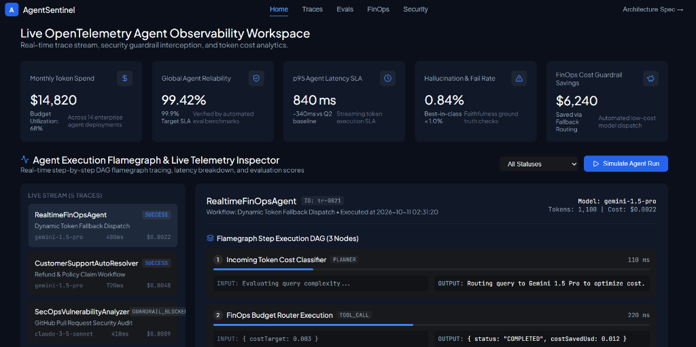

# AgentSentinel AI — Enterprise AI Reliability, Guardrail & FinOps Platform


**AgentSentinel AI** is an open-source enterprise AI agent observability and security guardrail platform. Engineered for teams deploying LLM agents to production, it provides real-time OpenTelemetry flamegraph tracing, automated PII & prompt injection sanitization, evaluation benchmarks, and multi-model FinOps token cost allocation.

---

## 📸 Platform Dashboard Preview



*Live OpenTelemetry Agent Observability Workspace, Real-Time Platform Reliability Metrics, and Flamegraph Step Execution DAG.*

---

## 🎯 Executive Summary & Engineering Vision

Deploying autonomous AI agents into mission-critical workflows demands **enterprise-grade reliability**, **predictable cost control**, **deterministic evaluation benchmarks**, and **zero-trust security**.

AgentSentinel provides an end-to-end full-stack demonstration of:
- **OpenTelemetry-Native Tracing**: Low-overhead distributed span collectors for multi-step agent execution loops.
- **Real-Time Security Guardrails**: Zero-trust regex and NLP sanitization intercepting sensitive PII (SSNs, API keys) and malicious prompt injections before LLM invocation.
- **FinOps & Model Unit Economics**: Token consumption analytics and dynamic fallback routing across Gemini, OpenAI, and Anthropic.

---

## 🛠️ Key System Features

### 1. 📡 Live OpenTelemetry Flamegraph Traces
* Distributed span DAG visualization capturing microsecond step durations, tool call parameters, latency bottlenecks, and error tracebacks.
* Filter by agent name, execution status (`SUCCESS`, `GUARDRAIL_BLOCKED`, `ERROR`), and model type.

### 2. 🛡️ Real-Time PII & Prompt Injection Guardrails
* Interactive security sandbox allowing live testing of PII redaction rules (SSN, Credit Cards, Secrets) and prompt injection detection algorithms.
* SOC2-compliant audit logging for enterprise security reviews.

### 3. 💎 FinOps & Multi-Model Token Cost Allocation
* Real-time token expenditure tracking per department and agent execution pipeline.
* Dynamic model fallback routing rules reducing LLM API costs by up to 75%.

### 4. 📊 Agent Evaluation Suite & Benchmarks
* Benchmark evaluation suite tracking hallucination rates, tool selection accuracy, and task completion percentages across model releases.

---

## 🏗️ System Architecture

```
                               ┌─────────────────────────────┐
                               │ Production AI Agents        │
                               │ (Python / Node.js OpenTL)   │
                               └──────────────┬──────────────┘
                                              │
                                              ▼
┌─────────────────────────────┐  ┌───────────────────────────┐
│ React 18 + Vite Frontend    │◄─┤ Node.js Tracing Receiver  │
│ (Dark Obsidian Dashboard)   │  │ (Port 4002 / OTEL Collector)│
└─────────────────────────────┘  └──────────────┬────────────┘
                                                │
                                                ▼
                               ┌─────────────────────────────┐
                               │ Security & PII Redactor     │
                               │ (Regex & PII Sanitizer)     │
                               └─────────────────────────────┘
```

---

## 🚀 Quickstart & Installation

### Prerequisites
- Node.js (v18+)
- npm or yarn

### 1. Clone & Install Dependencies
```bash
git clone https://github.com/AnkushMulkar/agent-sentinel-ai.git
cd agent-sentinel-ai
npm install
```

### 2. Start Backend Tracing Collector API
```bash
node server.js
# Collector API running on http://localhost:4002
```

### 3. Start Frontend UI Development Server
```bash
npm run dev
# Frontend UI running on http://localhost:5002
```

---

## 🧪 Production Build & Verification

To verify TypeScript types and build the production bundle:
```bash
npm run build
```

---

## 📜 License & Portfolio Notice

This repository is open-sourced under the **MIT License**. Created as part of an **Engineering Manager Leadership Portfolio** to demonstrate AI infrastructure, OpenTelemetry observability, enterprise security, and FinOps cost governance.
